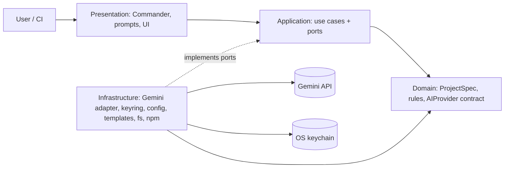
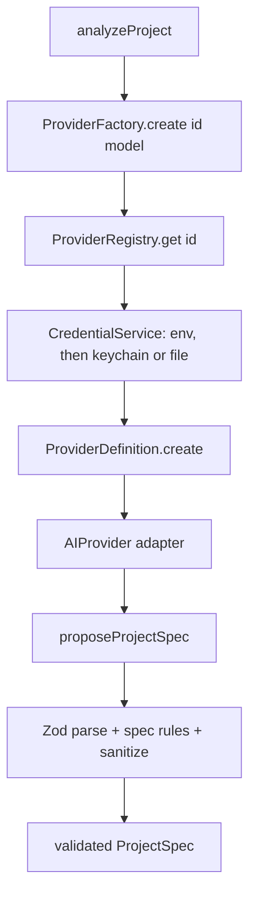

# ExpressForge

[](https://github.com/iamishanjain/express-ai-cli-starter/actions/workflows/ci.yml)
[](https://www.npmjs.com/package/expressforge)
[](LICENSE)

Generate an Express.js API starter from your terminal. Optionally, let an AI provider read your project description and propose a data model. You review and approve it before a single file is written.

```bash
npx expressforge
```

## Why ExpressForge

- **Fast start, no lock-in.** You get a plain Express 5 project (JavaScript or TypeScript) with its own `package.json`. Nothing in it depends on ExpressForge.
- **AI is optional and supervised.** The AI only _proposes_ a validated schema. It never generates or runs code, and nothing is written until you approve the proposal.
- **Your API key stays yours.** Keys are stored in the operating system's credential store, never in your project, never in a plaintext config file by default, and never printed.
- **Works in CI.** Every prompt has a flag, and the tool never hangs waiting for input.
- **Extensible.** New AI providers, databases, languages and templates plug in without changing the core. See [CONTRIBUTING.md](CONTRIBUTING.md).

## Features

- Interactive wizard and fully scriptable flags
- JavaScript or TypeScript projects
- PostgreSQL, MySQL, MongoDB or no database
- AI-proposed logical schema (entities, fields, assumptions), validated with Zod
- First-run setup with a masked API-key prompt and live key verification
- Secure credential storage (macOS Keychain, Windows Credential Manager, Linux Secret Service)
- Config commands to replace, validate and remove credentials
- Template-driven generation: add a template by adding a folder

## Prerequisites

- Node.js 20 or newer
- npm
- A [Google Gemini API key](https://aistudio.google.com/apikey), only if you want AI schema suggestions

## Installation

```bash
# one-off, no install
npx expressforge

# or install globally
npm install -g expressforge
expressforge
```

The command is available as both `expressforge` and `create-express-ai` (the original name, kept for compatibility).

## First-run configuration

The first time you run `expressforge` in a terminal, it asks whether you want AI-powered analysis:

```text
First-time setup
? Enable AI-powered project analysis? Yes
Provider: Google Gemini
Create a key at https://aistudio.google.com/apikey

? Google Gemini API key: ********************************
✔ API key verified.
✔ API key saved (in the OS credential store).
```

- The key is entered in a **masked** prompt and is verified with a minimal request to the provider before it is saved.
- If verification fails you see a clear message and can retry.
- If you decline, ExpressForge carries on without AI and does not ask again. Run `expressforge config set` whenever you change your mind.
- If you already have `GEMINI_API_KEY` set in your environment, no setup is needed.

### Where is my key stored?

| Platform | Default location                             |
| -------- | -------------------------------------------- |
| macOS    | Keychain (service `expressforge`)            |
| Windows  | Credential Manager (service `expressforge`)  |
| Linux    | Secret Service (GNOME Keyring, KWallet, ...) |

If no credential store is available (for example a headless Linux box), ExpressForge **does not silently downgrade**. It tells you, and offers a plaintext fallback only if you explicitly agree (or pass `--insecure-file-storage`). That file is `credentials.json` in the config directory, with mode `0600` in a `0700` directory. It is **not encrypted**. Prefer an environment variable on such machines.

### Configuration directory

Non-secret settings live in `config.json`:

| Platform | Directory                                                   |
| -------- | ----------------------------------------------------------- |
| macOS    | `~/Library/Application Support/expressforge`                |
| Windows  | `%APPDATA%\expressforge`                                    |
| Linux    | `$XDG_CONFIG_HOME/expressforge` or `~/.config/expressforge` |

Set `EXPRESSFORGE_CONFIG_DIR` to use another directory. `expressforge config get path` prints the exact path.

### Updating or removing credentials

```bash
expressforge config set        # replace the API key (masked prompt)
expressforge config validate   # check the stored key still works
expressforge config remove     # delete the config and every stored key
```

### Precedence

Settings are resolved in a fixed order, highest first:

1. Command-line flags (`--provider`, `--model`)
2. Environment variables: `EXPRESSFORGE_PROVIDER`, `EXPRESSFORGE_MODEL`, then the provider's own variables (`GEMINI_API_KEY`, `GEMINI_MODEL`)
3. Stored configuration (`config.json` and the credential store it points to)
4. Built-in defaults (`gemini`, `gemini-2.5-flash`)

The API key follows the same idea: `GEMINI_API_KEY` wins over a stored key. ExpressForge never reads a `.env` file from your current directory.

## Usage

```bash
# Interactive wizard
expressforge

# Scripted, no AI
expressforge create --name my-api --language typescript --database postgresql --no-ai --install

# Accept all defaults (TypeScript + PostgreSQL), no prompts
expressforge create --yes --name my-api

# Scripted with AI (the proposal must be pre-approved explicitly)
GEMINI_API_KEY=... expressforge create --name shop-api --database mysql \
  --description "An online shop with products, customers and orders" \
  --language typescript --ai --approve-schema
```

### Commands

| Command                               | What it does                                                                                 |
| ------------------------------------- | -------------------------------------------------------------------------------------------- |
| `expressforge [create]`               | Create a project (default command)                                                           |
| `expressforge config` / `config show` | Show settings; never prints API keys (`--json` available)                                    |
| `expressforge config get <key>`       | Print one of `provider`, `model`, `ai`, `backend`, `path`                                    |
| `expressforge config set`             | Set up or replace the API key; `--model`, `--provider`, `--stdin`, `--insecure-file-storage` |
| `expressforge config validate`        | Verify the configured key with the provider                                                  |
| `expressforge config remove`          | Remove the configuration and stored keys (`--yes` to skip the prompt)                        |
| `expressforge providers [list]`       | List AI providers and key status (`--json` available)                                        |
| `--help`, `-V` / `--version`          | Help and version                                                                             |

`create` flags: `--name`, `--description`, `--language`, `--database`, `--provider`, `--model`, `--ai` / `--no-ai`, `--approve-schema`, `--install` / `--no-install`, `--yes`. Add `--debug` to any command for technical details (secrets stay redacted).

### Non-interactive mode and CI

Prompts are disabled when there is no terminal, when `CI` is set, or when you pass `--yes`. In that mode:

- Anything the wizard would ask must be given as a flag. A missing one fails with exit code 2 and names the flag.
- AI is used only with `--ai`, needs the key in the environment, and requires `--approve-schema`, because the approval step cannot be interactive.
- Dependencies are installed only with `--install`.
- To store a key from a script: `echo "$KEY" | expressforge config set --stdin`.

### Exit codes

| Code | Meaning                                                        |
| ---- | -------------------------------------------------------------- |
| 0    | Success                                                        |
| 1    | Unexpected error                                               |
| 2    | Usage or validation error (bad flag, missing input)            |
| 3    | Configuration or credential problem (missing/invalid key)      |
| 4    | AI provider problem (unreachable, rate limited, bad response)  |
| 5    | Filesystem or template problem (directory exists, permissions) |
| 130  | Cancelled with Ctrl+C                                          |

## Supported languages and databases

| Languages  | Databases                                                       |
| ---------- | --------------------------------------------------------------- |
| TypeScript | PostgreSQL (`pg`), MySQL (`mysql2`), MongoDB (`mongoose`), none |
| JavaScript |                                                                 |

The database choice adds the driver and `.env.example` entries. Connection code and migrations are not generated yet (see the [roadmap](#roadmap)).

## AI-powered schema generation

1. You describe the application. ExpressForge sends the description and chosen database to the provider.
2. The provider returns a structured proposal: entities, fields, types, assumptions.
3. The response is treated as **untrusted input**: parsed as JSON, validated against a strict schema, checked for duplicate names and required `id` keys, length-limited, and stripped of terminal control characters.
4. You see the proposal and approve or reject it. Rejecting writes nothing.
5. The approved proposal is saved as `src/generated/schema.json`. It is data, not code, and nothing in it is executed.

Currently **Google Gemini** is the only implemented provider. The architecture is ready for more (see [Roadmap](#roadmap)).

## Generated project structure

```text
my-api/
├── .env.example          # PORT, NODE_ENV and database variables
├── .gitignore
├── README.md
├── package.json          # independent of ExpressForge
├── tsconfig.json         # TypeScript projects only
└── src/
    ├── app.ts            # Express app (helmet, cors, json, /health)
    ├── server.ts
    ├── generated/
    │   └── schema.json   # approved AI proposal, or an empty placeholder
    └── controllers/ routes/ models/ services/ middlewares/ config/ validators/ utils/
```

```bash
cd my-api
cp .env.example .env
npm install     # skipped if you passed --install
npm run dev     # http://localhost:3000/health
```

## Architecture





More diagrams and the design rationale are in [docs/architecture.md](docs/architecture.md). Decisions are recorded in [docs/adr](docs/adr).

## Troubleshooting

| Symptom                                           | Fix                                                                                           |
| ------------------------------------------------- | --------------------------------------------------------------------------------------------- |
| `INVALID_API_KEY`                                 | Run `expressforge config set` and paste a fresh key.                                          |
| `CREDENTIAL_STORE_UNAVAILABLE`                    | No keychain found. Set `GEMINI_API_KEY`, or opt in with `config set --insecure-file-storage`. |
| `RATE_LIMITED` / `NETWORK_TIMEOUT`                | Wait and retry; check your quota and connection. Requests time out after 60 seconds.          |
| `UNSUPPORTED_MODEL`                               | Choose another with `expressforge config set --model <id>`.                                   |
| `PROJECT_EXISTS`                                  | Pick another name or remove the directory. Existing files are never overwritten.              |
| `--name is required when prompts are unavailable` | You are in CI or piping input; pass the flag or use `--yes`.                                  |
| `npm install failed`                              | The project was still generated; run `npm install` inside it.                                 |
| Something else                                    | Re-run with `--debug` and include the output (secrets are redacted) in an issue.              |

## Security considerations

- API keys are never printed, logged, put in error messages, written to generated projects, or read from your project's `.env`.
- Errors are redacted before display; `--debug` output is redacted too.
- Keys are not accepted as command-line arguments (they would leak into shell history and process lists). Use the prompt, `--stdin`, or the environment.
- AI output is validated and sanitized, never executed, and requires your approval.
- Generated paths are validated to stay inside the project; existing files are never overwritten.
- `npm install` is run without a shell, with a fixed argument list.

See [SECURITY.md](SECURITY.md) for how to report a vulnerability.

## Contributing

Contributions are welcome. Start with [CONTRIBUTING.md](CONTRIBUTING.md), which explains how to run the project, add an AI provider, and add a template. Please read the [Code of Conduct](CODE_OF_CONDUCT.md).

## Roadmap

Near term: OpenAI, Groq, Anthropic and Ollama providers; model selection and provider switching; database connection and migration scaffolding; Docker and Docker Compose files; authentication module; NestJS and Fastify templates.

Longer term: add modules to existing projects, OpenAPI generation, a community template catalog. Nothing here is implemented yet; the provider and template architecture was built so these can be added without touching the core.

## License

[MIT](LICENSE)
