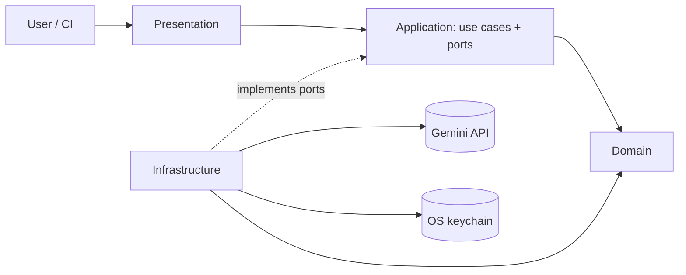
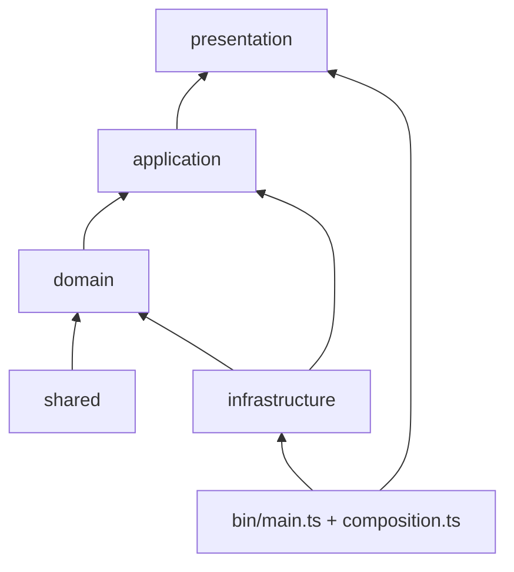
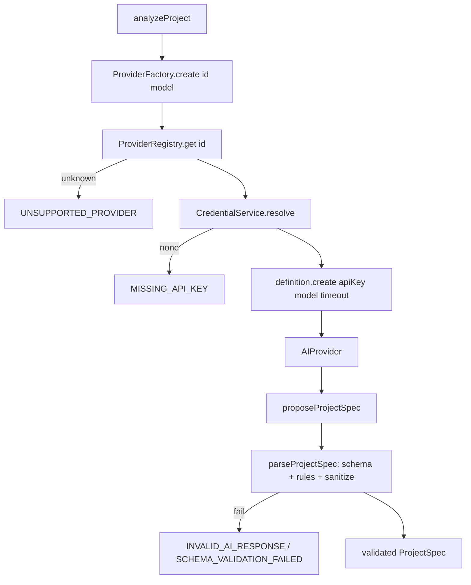
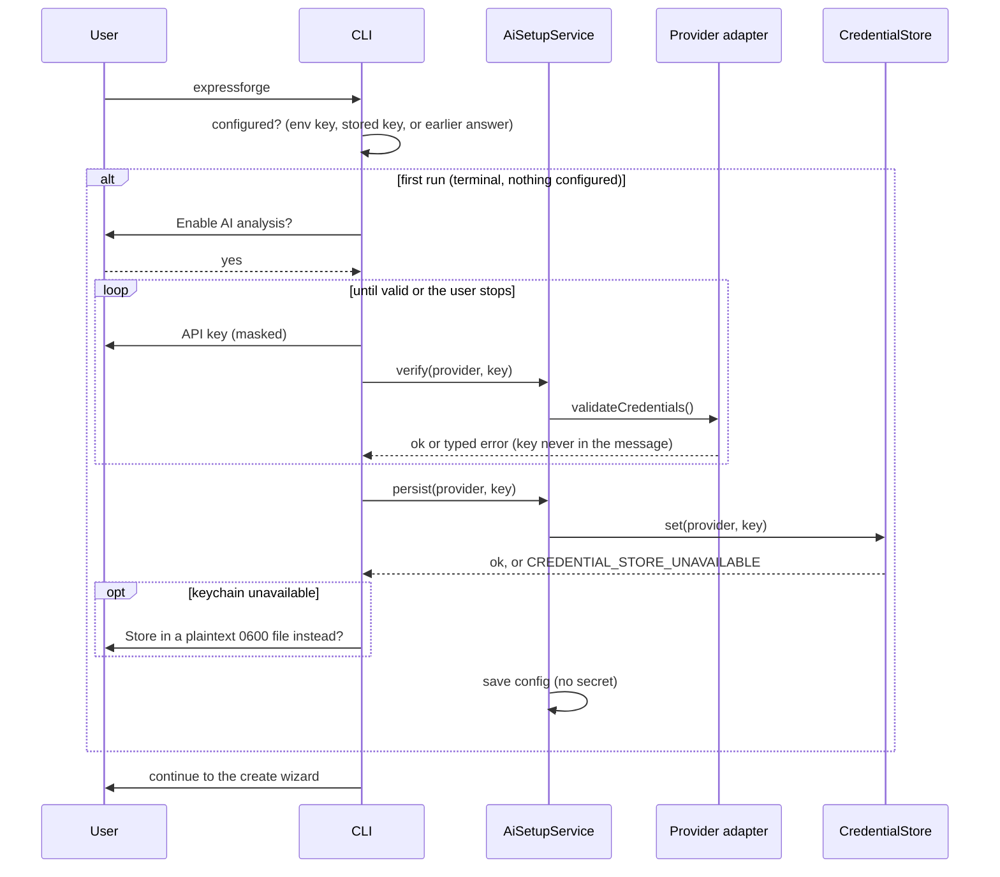
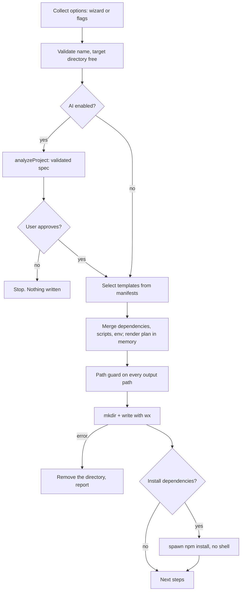

# Architecture

ExpressForge follows Clean Architecture with a single rule: **dependencies point inward**. ESLint enforces it (`no-restricted-imports` in `eslint.config.js`), so a wrong import fails the build.

| Layer            | Owns                                                                              | May import                        |
| ---------------- | --------------------------------------------------------------------------------- | --------------------------------- |
| `domain`         | `ProjectSpec` schema and rules, `AIProvider` contract                             | `shared/errors` only              |
| `application`    | use cases, services, ports (interfaces)                                           | `domain`, `shared`                |
| `infrastructure` | Gemini adapter, credential stores, config files, template engine, filesystem, npm | `application`, `domain`, `shared` |
| `presentation`   | Commander commands, prompts, terminal output                                      | `application`, `domain`, `shared` |
| `shared`         | errors, logger, redaction, constants                                              | nothing else                      |
| `composition.ts` | wires concrete implementations together                                           | everything                        |

## Provider abstraction

`src/domain/ai-provider.ts` defines `AIProvider` (validate credentials, list models, propose a spec), `ProviderMetadata` and `ProviderDefinition` (metadata plus a `create` function). The application layer depends only on these.

- `ProviderRegistry` holds definitions. Adding a provider is one `register` call in `composition.ts`.
- `ProviderFactory` turns an id into an adapter: registry lookup, credential resolution, `definition.create`.
- Adapters live in `infrastructure/providers/<id>/` and are the only code that imports their SDK. They translate SDK errors into `ExpressForgeError` codes and never forward raw SDK messages.
- After any adapter returns, `analyzeProject` validates the result again, so an adapter cannot skip validation.

## Configuration and credentials

- `config.json` (versioned, no secrets) lives in the OS config directory. `migrateConfig` upgrades older versions step by step and refuses files written by a newer version.
- `CredentialStore` is a port with two implementations: `KeyringCredentialStore` (OS credential store, loaded lazily so a missing native binary becomes a typed error) and `FileCredentialStore` (mode `0600`, only after explicit consent).
- `CredentialService` resolves a key: environment variable first, then the backend recorded in `config.json`. It never falls back to another backend by itself.
- `SettingsResolver` resolves provider and model: flags, then environment, then stored config, then defaults.

## Template engine

Templates are folders: `templates/base`, `templates/language/<option>`, `templates/database/<option>`. Each has a `template.json` manifest (validated with Zod) declaring dependencies, scripts, `.env.example` lines, variables and files.

`FileSystemTemplateSource` discovers and validates manifests (id matches folder, referenced files exist). `selectTemplates` picks base plus one template per category. `mergeTemplates` combines them deterministically and rejects conflicting values. `buildPlan` renders every file in memory (`{{variable}}` substitution; unknown variables fail). `TemplateProjectGenerator` validates every output path, creates the directory (`mkdir` without `recursive`, so an existing directory is an error), writes with `wx` (never overwrite), and removes the directory if anything fails.

## CLI and errors

Commander builds the command tree in `presentation/cli/program.ts`. Handlers call flows and use cases through a `CliContext` assembled by `composition.ts`; tests build the same context with fakes.

All failures are `ExpressForgeError(code, message, { hint, details, cause })`. Messages are redacted on construction. `formatError` prints `✖ message (CODE)` plus the hint, and adds details only with `--debug`. Each code maps to an exit code (see the README).

Ctrl+C: prompts throw `CANCELLED`; the first SIGINT aborts a shared `AbortSignal` that stops provider requests and `npm install`, and generated files are removed if they were already written; a second SIGINT exits immediately.

## Testing architecture

- `tests/unit`: pure logic and adapters with injected fakes.
- `tests/integration`: the real use cases and template engine against temporary directories, with the Gemini SDK replaced by a fake client.
- `tests/cli`: the real command tree driven in-process with scripted prompts, plus the built binary spawned as a subprocess.
- `tests/helpers`: `createTestEnvironment` wires the production composition root with a fake keychain, fake provider, scripted prompter and a temp directory. No test needs a network or a real API key.
